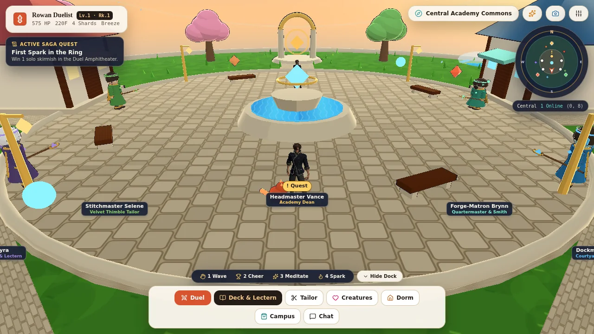
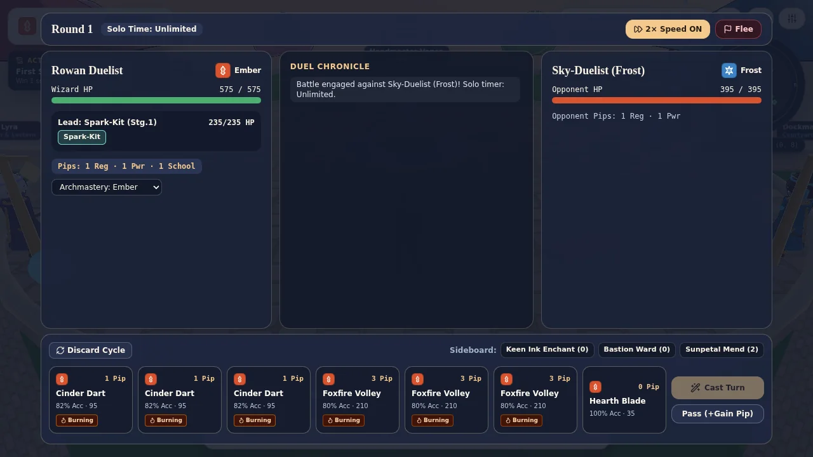

# AlderVale: Pact of Ten

AlderVale is a 3D browser RPG set at a spellcasting academy among floating islands. Create a wizard, explore the campus, and build a deck for turn-based duels.

**In development · Local guest play.** Start in Breeze, earn your first quest rewards in a solo duel, and return to the same wizard after a reload.

[Run locally](#run-locally) · [First playthrough](#first-playthrough) · [How AI helps build AlderVale](#how-ai-helps-build-aldervale) · [Report a bug](#report-a-bug)



*Breeze’s Central Academy Commons. In-game capture from build `3fa20bc`.*

## Run locally

You’ll need Git, Node.js **24.12.0 or later**, Bun **1.4.4**, and a browser with **WebGL 2** for the 3D campus.

```bash
git clone https://github.com/vixttha/AlderVale-Pact-of-Ten.git
cd AlderVale-Pact-of-Ten
bun install --frozen-lockfile
bun run dev
```

Keep the terminal open and visit [http://localhost:3000](http://localhost:3000). Guest play works without a Google account or an API key.

## First playthrough

1. **Create your wizard.** Choose **Breeze**, enter a wizard name, and pick **Alder Human** with the **Rowan** appearance. Select **Begin Academy Journey**.
2. **Enter a duel.** On campus, open **Duel** and select **Frost** under **Solo Academy Skirmishes**. Pick an affordable spell and select **Cast Turn**, or use **Pass (+Gain Pip)** to build pips.
3. **Claim First Spark.** After winning, select **Claim Rewards & Return**. Open **Active Saga Quest** and check that **First Spark in the Ring** shows **Completed**.
4. **Resume your wizard.** Reload the page, select the same wizard in Breeze, and choose **Enter Aldervale**. Check that the quest is still complete and your Florin and Spell Shard totals match.



*First Spark in Breeze. In-game capture from build `3fa20bc`.*

### Choose a realm

| Realm | In-game pacing label |
| --- | --- |
| **Breeze** | ~25-Min Fast Path |
| **Horizon** | ~1-Hr Balanced Path |
| **Everpeak** | ~3-Hr Classic Saga |

The labels describe progression tuning. Actual playtime varies.

## How AI helps build AlderVale

AlderVale is a public record of AI-assisted game development. AI assists with implementation, debugging, and test design. Project decisions and release approvals stay under human control.

**First Spark, from duel to saved progress.** The AI-assisted test work made the browser scenario repeatable while keeping the actual game controls, combat, and reward logic. It checks that Rowan earns the expected payout and that the same wizard, completed quest, Florins, and Spell Shards survive a reload. The scenario passed in Chromium, Firefox, and WebKit on build `3fa20bc`. [Test changes](https://github.com/vixttha/AlderVale-Pact-of-Ten/pull/61) · [Build validation](https://github.com/vixttha/AlderVale-Pact-of-Ten/actions/runs/43890556938)

## Troubleshooting

- **3D world unavailable.** Try **Retry 3D**. You can still access your wizard and menus.
- **Guest save failed.** Allow browser site storage, then select **Retry save** before reloading or closing the tab.
- **Wizard missing after reload.** Use the same browser profile, URL, and realm. Clearing site data removes local guest saves.

## Validation

Run `bun run validate:core` for type checking, rules lint, tests, the production build, and HTTP and WebSocket checks. GitHub Actions also runs guest journeys in Chromium, Firefox, and WebKit and checks Firestore rules in an emulator.

- [Validation guide](https://github.com/vixttha/AlderVale-Pact-of-Ten/blob/main/docs/VALIDATION.md)
- [Test Vault](https://github.com/vixttha/AlderVale-Pact-of-Ten/blob/main/docs/test-vault/README.md)
- [GitHub Actions](https://github.com/vixttha/AlderVale-Pact-of-Ten/actions)

## Report a bug

Search [GitHub Issues](https://github.com/vixttha/AlderVale-Pact-of-Ten/issues) first. Include the build or commit, browser, operating system, realm, steps to reproduce, and what you expected to happen.
