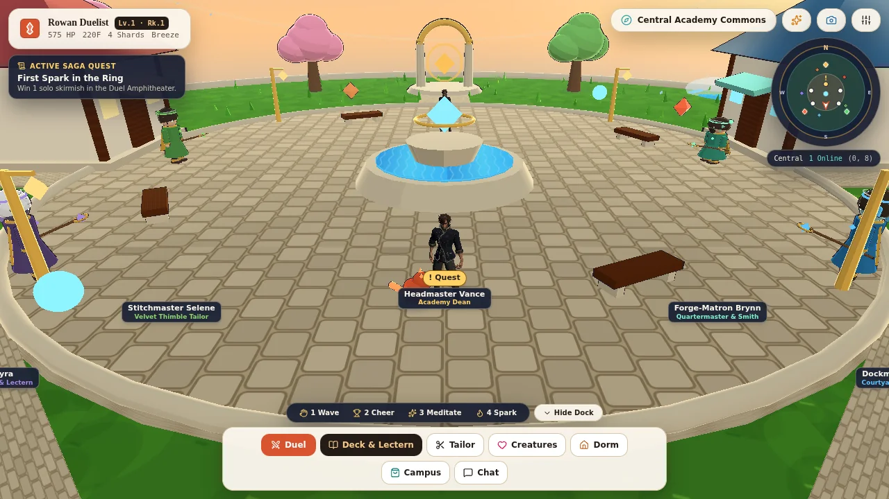
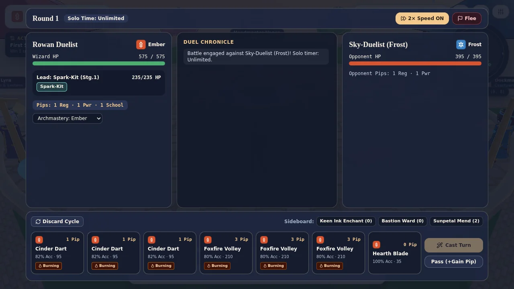

# AlderVale: Pact of Ten


AlderVale is a 3D browser RPG set at a spellcasting academy among floating islands. Create a wizard, explore the campus, and build a deck for turn-based duels.

**In development · Local guest play.** Start in Breeze and earn your first quest rewards in a solo duel. You can play as a guest without a Google account or API key.

[Play on Windows](#play-on-windows) · [Run from source](#run-from-source) · [First playthrough](#first-playthrough) · [Bazaar](#bazaar) · [Report a bug](#report-a-bug)

## Play on Windows

In your local copy of the repository, open **AlderVale Play** and double-click **Play AlderVale.cmd**. Install Git and Node.js **24.12.0 or later** first. The launcher builds the game and opens it at [http://127.0.0.1:4178](http://127.0.0.1:4178). Keep the launcher window open while you play. [Windows launcher guide](https://github.com/vixttha/AlderVale-Pact-of-Ten/blob/main/AlderVale%20Play/README.md)

## Run from source

Install Git, Node.js **24.12.0 or later**, and Bun **1.4.4**. The 3D campus requires WebGL 2.

```bash
git clone https://github.com/vixttha/AlderVale-Pact-of-Ten.git
cd AlderVale-Pact-of-Ten
bun install --frozen-lockfile
bun run dev
```

Keep the terminal open and visit [http://localhost:3000](http://localhost:3000). Guest saves are stored by browser profile and address. Stick with the launcher address or the source address to resume the same save.



*Breeze’s Central Academy Commons. In-game capture from build `3fa20bc`.*

## First playthrough

1. **Create your wizard.** Choose **Breeze**, enter a wizard name, and pick **Alder Human** with the **Rowan** appearance. Select **Begin Academy Journey**.
2. **Enter a duel.** On campus, open **Duel** and select **Frost** under **Solo Academy Skirmishes**. Pick an affordable spell and select **Cast Turn**, or use **Pass (+Gain Pip)** to build pips.
3. **Claim First Spark.** After winning, select **Claim Rewards & Return**. Open **Active Saga Quest** and check that **First Spark in the Ring** shows **Completed**.
4. **Resume your wizard.** Reload the page, select the same wizard in Breeze, and choose **Enter Aldervale**. Check that the quest is still complete and your Florin and Spell Shard totals match what you saw before reloading.



*First Spark in Breeze. In-game capture from build `3fa20bc`.*

### Choose a realm

| Realm | In-game pacing label |
| --- | --- |
| **Breeze** | ~25-Min Fast Path |
| **Horizon** | ~1-Hr Balanced Path |
| **Everpeak** | ~3-Hr Classic Saga |

The labels describe progression tuning. Actual playtime varies.

## Bazaar

Sign in to buy and sell gear in your wizard’s realm. The Bazaar uses the Florins in that realm’s Bazaar wallet. Academy shops use your wizard’s Florins.

- **Buy gear.** Select **Buy** on a listing you can afford. The item becomes available in **Tailor → Equip Gear**.
- **Sell gear.** If the item is equipped, equip a different piece in the same slot in **Tailor**. In the Bazaar, select the item and choose **List for Florins**. One copy is reserved until it sells or you choose **Cancel listing**. When it sells, your Bazaar wallet updates automatically if you’re still connected in that realm.

## Troubleshooting

- **3D world unavailable.** Try **Retry 3D**. You can still access your wizard and menus.
- **Guest save failed.** Allow browser site storage, then select **Retry save** before reloading or closing the tab.
- **Wizard missing after reload.** Use the same browser profile, local address, and realm. Clearing site data removes local guest saves.

## Development and testing

Run `bun run validate:core` for type checking, rules lint, tests, the production build, and HTTP and WebSocket checks. GitHub Actions also runs guest journeys in Chromium, Firefox, and WebKit and checks Firestore rules in an emulator.

- [Validation guide](https://github.com/vixttha/AlderVale-Pact-of-Ten/blob/main/docs/VALIDATION.md) · [GitHub Actions](https://github.com/vixttha/AlderVale-Pact-of-Ten/actions)
- [First-playable test coverage and desktop checklist](https://github.com/vixttha/AlderVale-Pact-of-Ten/blob/main/docs/test-vault/aldervale/README.md) · [Test Vault](https://github.com/vixttha/AlderVale-Pact-of-Ten/blob/main/docs/test-vault/README.md)

### AI-assisted development

AI assists with implementation, debugging, and test design. The First Spark browser test uses the game controls to win a duel, claim the payout, and verify the quest and rewards after reload. [Test changes](https://github.com/vixttha/AlderVale-Pact-of-Ten/pull/61) · [Build validation](https://github.com/vixttha/AlderVale-Pact-of-Ten/actions/runs/43917481646)

## Report a bug

Search [GitHub Issues](https://github.com/vixttha/AlderVale-Pact-of-Ten/issues) first. Include the build or commit, browser, operating system, and realm. List the steps to reproduce the bug, what you expected, and what actually happened.
